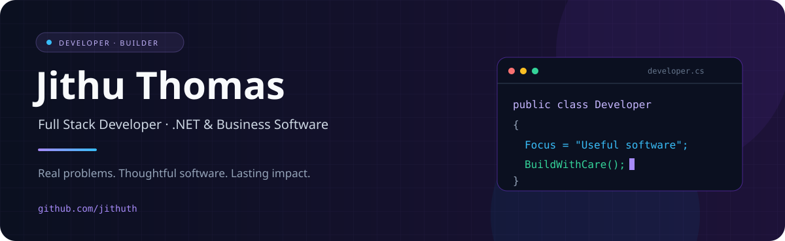

 

**I turn everyday business challenges into useful software.**

 

[About](#-the-person-behind-the-code) · [Toolkit](#-my-development-toolkit) · [Projects](#-explore-my-work) · [Connect](#-have-a-problem-worth-solving)

---

## 👨‍💻 The person behind the code

<table>
<tr>
<td width="58%" valign="top">

### Hello, I'm Jithu 👋

I'm a full stack developer focused on **ASP.NET Core, SQL Server, and business applications**. My experience in engineering and technical operations shapes how I approach software: understand the work, simplify the process, and make the result useful.

🧩 **Building:** business software, ecommerce, and SaaS  
⚡ **Exploring:** AI integrations and workflow automation  
🛠️ **Valuing:** clear architecture and maintainable code  
🌱 **Driven by:** practical problems that deserve better tools

</td>
<td width="42%" align="center" valign="middle">

 
From understanding the problem to shipping the solution.
</td>
</tr>
</table>

## 🛠️ My development toolkit

  
  
  
  
  
  
  
  
  
  

| Build layer | My tools |
| :--- | :--- |
| **Backend & APIs** | C# · ASP.NET Core · Razor Pages · Entity Framework Core · Node.js · Laravel |
| **Frontend & experience** | JavaScript · TypeScript · Next.js · Tailwind CSS |
| **Databases** | SQL Server · MySQL · Supabase |
| **Desktop & mobile** | WPF · Windows Forms · Flutter |
| **Quality & delivery** | xUnit · Selenium · Git · GitHub |

## 🚀 Explore my work

<table>
<tr>
<td width="50%" valign="top">

### 🔧 Engineering & tools

Explore repositories from my tools collection.

**[Pipe Designer →](https://github.com/jithuth/pipedesigner)**  
**[Wire Calculator →](https://github.com/jithuth/Wirecalculator-main)**  
**[QuickUnlocker Web →](https://github.com/jithuth/Quickunlocker.Web)**

</td>
<td width="50%" valign="top">

### 🌐 Web & community

Explore repositories from my web collection.

**[Kuwait Malayali →](https://github.com/jithuth/kwmalayali)**  
**[Only Cotton →](https://github.com/jithuth/onlycotton)**  
**[Product Canvas →](https://github.com/jithuth/Productcanvas)**

</td>
</tr>
</table>

[**Browse all my repositories ↗**](https://github.com/jithuth?tab=repositories)

## 💡 How I approach a build

| Understand | Design | Build | Improve |
| :--- | :--- | :--- | :--- |
| Learn the real workflow | Keep the experience clear | Write maintainable code | Test, listen, and refine |

---

## 🤝 Have a problem worth solving?

I'm interested in **.NET development, business applications, and practical automation**.

 

*Good software starts with understanding the problem.*

